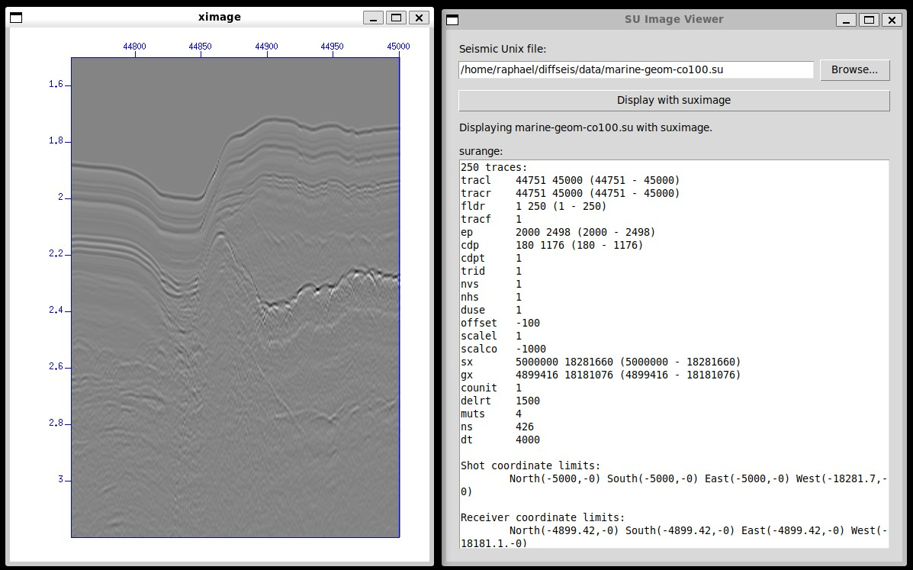

# SUviewer



## What is SUviewer?

Tkinter launcher for displaying Seismic Unix files with `suximage`.

Install Seismic Unix first and ensure `suximage` is available on your `PATH`, then run:

```bash
python app.py
```

## Executable

Download the AppImage from the *releases* and run it by following the instructions below

```bash
chmod +x SUviewer-x86_64.AppImage
./SUviewer-x86_64.AppImage
```